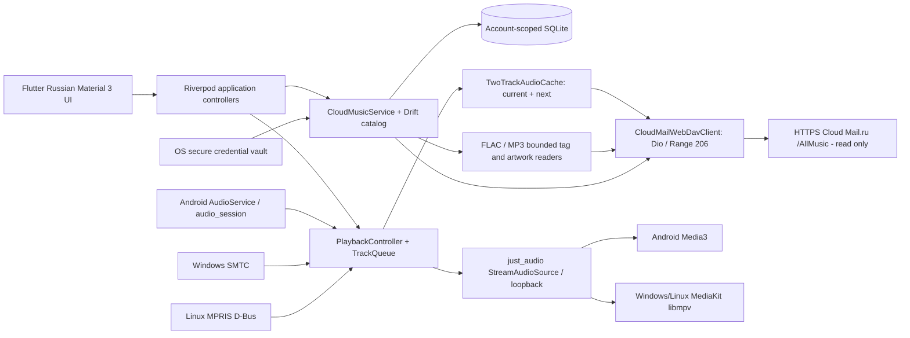

# teStPlaYclouDE architecture — actual integrated main (2026-11-06)

## Directory map / responsibilities

- `lib/domain`: RemoteTrack, album/disc ordering and logical queue. No OS dependencies.
- `lib/cloud`: Dio-based read-only CloudMailWebDavClient (Depth:1 PROPFIND, strict 206 Range) and credential vault/connection service.
- `lib/data/db`: Drift schema version 1; account-specific filename is truncated SHA-256 of login; SQLite opened in background isolate. One `remote_files` table, generation replacement, indexed tags.
- `lib/data/library`: CloudMusicService session, catalog updates and four metadata workers; source snapshots forwarded to UI.
- `lib/data/tags`, `artwork`: own bounded FLAC/MP3 and embedded picture readers; persistent thumbnails decoded/converted in isolate (JPEG 640px quality 85; 64 MiB per account). Separate in-memory current-cover cache.
- `lib/data/audio`: PlaybackController, StreamAudioSource and temporary two-track 512 MiB quota cache; 64 KiB network pages, current before next, canceled/cleaned on Stop.
- `lib/platform/{android,windows,linux}`: foreground MediaSession/focus, SMTC, MPRIS; bidirectional system controls use one PlaybackController. System media surfaces are optional and must not block sound.
- `lib/presentation`, `lib/app`: UI and composition; Russian strings in ARB. `android/`, `windows/`, `linux/` contain Flutter runners. `packaging/flatpak` is a development-only GNOME 51 sandbox.

## Data, privacy and lifecycle

1. Credentials entered locally through Settings, saved via flutter_secure_storage. CloudMusicService holds an in-memory copy only while session active. Connection change/disconnect invalidates providers and stops audio.
2. PROPFIND is bounded; response href decoded and checked beneath fixed `/AllMusic`. Audio/tag/cover requests use validated 64 KiB max GETs, RFC and provider `Content-Range` dialects, no external redirect following.
3. Catalog generation transaction prevents deleting indexed data after a failed remote listing. FLAC/MP3 tag extraction is bounded and concurrent, not full-track download.
4. Audio engine receives a local loopback stream, not a remote authenticated URL. Temporary audio cache contains plaintext audio data in OS temp storage and is not encryption-at-rest; discarded after Stop/restart. Cover cache is intentionally persistent and account-partitioned; review retention on disconnect.
5. Android: Media3 handles decode/system mixer, AudioService MediaSession exposes controls, default just_audio audio interruption handler. Windows/Linux: MediaKit/libmpv through native mixer with SMTC/MPRIS bridges.
6. Platform metadata intentionally includes track titles/artists for OS controls; no account password or HTTP Authorization data should be published. Android MediaItem ID currently contains relative track path; review privacy against OS visibility during hardened acceptance.

## Known design limits

Current UI/database read entire track lists (`readTracks()`), not true 50k keyset paging or FTS5. Metadata workers process up to 50k unindexed entries and emit snapshots every 32. SQLite schemaVersion=1 without migration evidence. No persistent audio cache across launches, playlist, telemetry, automated Cloud Mail access in GitHub Actions, or confirmed gapless playback. MPRIS and SMTC may have OEM/OS limitations. Maintain the raw-source and binary licensing distinction in RELEASE_AND_LICENSING.md.
